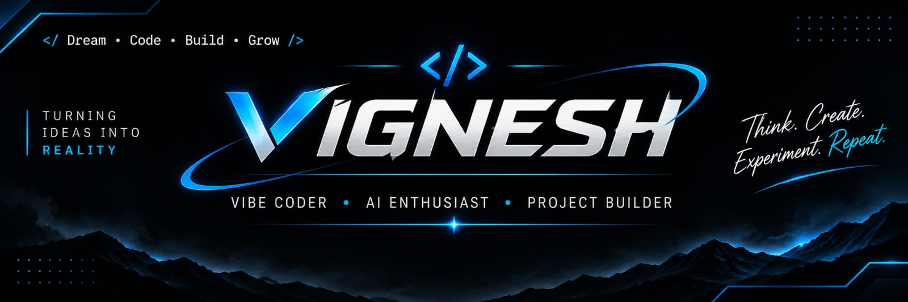

 

### Student Developer | AI Enthusiast | Project Builder

---

## 👨‍💻 About Me

Hi! I'm **Vignesh**, a BCA student passionate about technology, creativity and building digital products.

- 🚀 Vibe Coder who enjoys turning ideas into reality.
- 🤖 Exploring AI-powered development.
- 💡 Interested in creating useful digital products.
- 🌱 Currently learning Networking & OS, SQL and web technologies.
- 🎯 Focused on experimenting, building and improving.

---

## 🚀 Featured Projects

### 🌐 Portfolio
A showcase of my projects, skills, and development journey.

[🔗 Explore My Portfolio](https://vignesh-builds.vercel.app/)

### 📊 AttendWise
A smart attendance tracking platform designed to help students monitor their attendance.

[🔗 Live Project](https://pvtvigg-attendance.vercel.app/)

### 🗳️ ElectionFlow
A digital election management platform developed during a college hackathon.

[🔗 Live Project](https://election-flow.vercel.app/)

### 🎨 PVT.VIGG
A digital creative agency focused on creative design, video editing and web experiences.

[🔗 Visit Website](https://pvtvigg.vercel.app/)

---

## 🏆 Achievements

### 🥇 Hack2Skill – College Hackathon

- Developed ElectionFlow as a solo project.
- Achieved an AI dashboard evaluation score of **96.93/100**.
- Built the project within a 2-hour hackathon.

---

## ⚡ Tech Stack & Tools

### Web Development

### Tools & Platforms

### Currently Learning

- Python
- SQL
- AI-powered development
- Modern web technologies

---

## 📊 GitHub Statistics

  

---

## 📈 Contribution Activity

---

## 🤝 Let's Connect

---

### 💭 My Philosophy

*"Think. Create. Experiment. Repeat."*

**Thanks for visiting my profile! ⭐**

